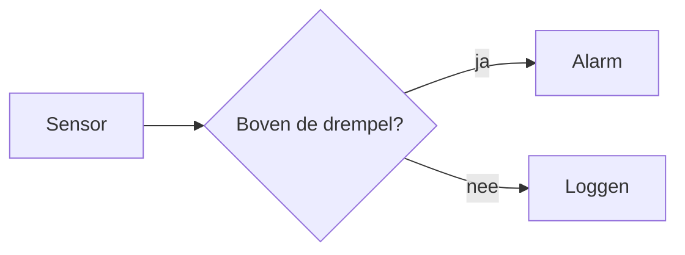
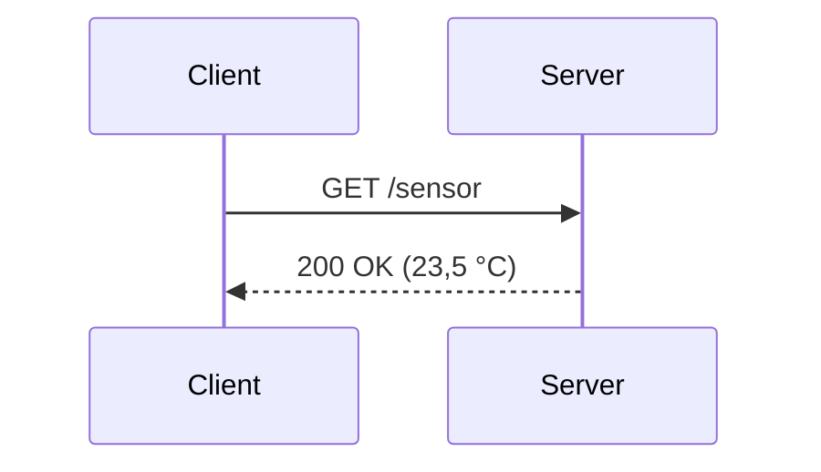

# Waarvoor dient deze deck?

- Een levende referentie van alles wat het AP-thema van de engine aanbiedt
- Elk onderdeel: eerst hoe het **eruitziet**, dan de **markdown-code** ervoor
- Doel: cards, kleuren en lay-outs **native in markdown** schrijven — geen losse `<div style="...">` meer in elke slide
- Dezelfde bouwstenen als de shortcodes van de Hugo-site: `migrate:hugo` zet oude decks automatisch om

---

# Inhoud

<Timeline>
<Step color="gray" label="1">Basis: een deck, slides, kleuren, tekst</Step>
<Step color="teal" label="2">Cards, pijlen en klikken</Step>
<Step color="green" label="3">Lay-out en afbeeldingen</Step>
<Step color="orange" label="4">Tijdlijnen en balken</Step>
<Step color="magenta" label="5">Diagrammen en formules</Step>
<Step color="red" label="6">Accenten en media</Step>
<Step color="gray" label="7">Presenteren: notes, AI-label, PDF</Step>
</Timeline>

---
layout: section
---

# Basis
## Een deck opbouwen

---

# Een nieuw deck: mappen

```
iot-datalab/                   ← de vakrepo
├── course.yml                 ← naam van het vak, auteur, notes
└── slides/
    └── les02-mqtt/            ← één deck
        ├── index.md           ← de slides
        ├── images/
        └── audio/
```

- De vakpagina toont elk deck met een knop **Slides** en **PDF**
- Afbeeldingen en geluid staan naast de slides — verwijs ernaar als `images/foto.jpg`

---

# Een nieuw deck: front matter

<Columns>
<Column>

**Vak** — `course.yml`

```yaml
title: IoT DataLab
author: Ward De Ridder
date: 2026–2027
notesMode: presenter
```

</Column>
<Column>

**Deck** — `slides/les02-mqtt/index.md`

```yaml
---
title: Les 2 — MQTT
order: 2
aiLabel: modified
---
```

</Column>
</Columns>

- `order` bepaalt de volgorde op de vakpagina; de titelslide maakt de engine zelf

---

# Slides en tussentitels

```md
# Gewone slide

- Een nieuwe slide begint na elke lijn ---

---
layout: section
---

# Tussentitel
## Nieuw hoofdstuk
```

- `layout: section` = rode achtergrond, zoals de tussentitels van dit deck
- Die front matter staat **meteen** na de `---`; een gewone slide begint met een **lege regel**

---

# Het kleurenpalet

<Cards>
<Card color="red" title="red">

#ad0f0a

</Card>
<Card color="gray" title="gray">

#404040

</Card>
<Card color="orange" title="orange">

#f69b00

</Card>
<Card color="magenta" title="magenta">

#ae1073

</Card>
<Card color="teal" title="teal">

#009eae

</Card>
<Card color="green" title="green">

#1d9759

</Card>
</Cards>

- Officiële AP-themakleuren, exact overgenomen uit het PowerPoint-sjabloon
- Elk onderdeel in dit deck aanvaardt één van deze 6 namen via `color="..."`

---

# Tekst, tabellen en code

<Columns>
<Column width="48%">

- Gewone **markdown**: *cursief*, **vet**, `code`, [links](https://www.ap.be)
  - Sublijstjes met twee spaties insprong

| Band | Golflengte |
|---|---|
| 868 MHz | 34,5 cm |
| 2,4 GHz | 12,5 cm |

</Column>
<Column width="48%">

```python
# codeblok met syntax highlighting
def golflengte(f_mhz):
    return 300 / f_mhz
```

</Column>
</Columns>

- Grote tabel? `class: compact-table` in de front matter van de slide maakt hem compacter

---

# Ook zonder component al in huisstijl

- Slide-titels (`#`) staan overal automatisch in AP-rood
- Tabellen en codeblokken krijgen vanzelf de juiste opmaak
- ` ```mermaid `-diagrammen gebruiken automatisch het AP-kleurenpalet — zie *Diagrammen en formules*
- Emoji werken overal als icoon (📡 🛰️ 🔋) — vlaggen niet op elk toestel, die dus liever vermijden

---
layout: section
---

# Cards
## De meest gebruikte bouwsteen

---

# Card: icoon + waarde + tekst

<Cards>
<Card color="teal" icon="🚀" value="1957">

lancering door de **USSR**

</Card>
<Card color="green" icon="📡" value="biep… biep…">eenvoudig, constant baken</Card>
<Card color="orange" icon="🔥" value="92 dagen">daarna verbrand in de atmosfeer</Card>
</Cards>

---

# Zo schrijf je dat

```
<Cards>
<Card color="teal" icon="🚀" value="1957">

lancering door de **USSR**

</Card>
<Card color="green" icon="📡" value="biep… biep…">eenvoudig, constant baken</Card>
</Cards>
```

- `icon`, `value`, `title` zijn **optioneel**; de body mag gewone markdown zijn
- Markdown in een component: **lege regel** ervoor en erna — korte platte tekst mag op één regel
- `stat` maakt de `value` nog groter — voor kaartjes met enkel een getal

---

# Card: titel + bullet-lijst

<Cards>
<Card color="green" title="✅ Voordelen">

- Uitzendingen over **grote gebieden**
- Blijft altijd op **dezelfde plaats**

</Card>
<Card color="red" title="❌ Nadelen">

- Hoge **vertraging**
- Grote, dure antennes nodig

</Card>
</Cards>

---

# Zo schrijf je dat

```
<Cards>
<Card color="green" title="✅ Voordelen">

- Uitzendingen over **grote gebieden**
- Blijft altijd op **dezelfde plaats**

</Card>
<Card color="red" title="❌ Nadelen">

- Hoge **vertraging**
- Grote, dure antennes nodig

</Card>
</Cards>
```

- Een lijst (`- item`) in de body wordt automatisch **links uitgelijnd**; gewone tekst blijft gecentreerd

---

# Card: outline (voor vergelijkingen)

<Cards>
<Card color="gray" title="Vroeger" outline>Productie volgt verbruik</Card>
<Card color="red" title="Nu" outline>Verbruik volgt productie</Card>
</Cards>

---

# Zo schrijf je dat

```
<Cards>
<Card color="gray" title="Vroeger" outline>Productie volgt verbruik</Card>
<Card color="red" title="Nu" outline>Verbruik volgt productie</Card>
</Cards>
```

- `outline` → rand in plaats van vulling, voor als de **kleur** minder belangrijk is dan de **inhoud**

---

# Card: bare (losse statistiek)

Gebruik dit voor **één** getal dat niet in een rij naast andere kaarten staat — géén vak, gewoon een groot gekleurd cijfer.

<Cards>
<Card color="red" value="≈ 550 ms" bare>RTT via GEO-satelliet</Card>
</Cards>

---

# Zo schrijf je dat

```
<Cards>
<Card color="red" value="≈ 550 ms" bare>RTT via GEO-satelliet</Card>
</Cards>
```

- Zet géén `bare` op kaarten die wél naast elkaar in een rij staan — dan wil je net de gekleurde vlakken

---

# Card: smal en gecentreerd (`width`)

Bij 1 of 2 korte kaarten (bv. enkel "5 m" / "20 cm") kan een volle rij te leeg ogen. Geef de kaart dan een vaste breedte:

<Cards>
<Card color="red" value="5 m" width="30%">sinds 2016</Card>
<Card color="green" value="20 cm" width="30%">sinds 2023</Card>
</Cards>

---

# Zo schrijf je dat

```
<Cards>
<Card color="red" value="5 m" width="30%">sinds 2016</Card>
<Card color="green" value="20 cm" width="30%">sinds 2023</Card>
</Cards>
```

- `width` accepteert elke CSS-breedte (`"30%"`, `"200px"`, ...); de rij centreert de kaartjes automatisch

---

# Arrow: een procesflow van cards

<Cards>
<Card color="teal" title="1. Meten">data verzamelen</Card>
<CardArrow />
<Card color="orange" title="2. Beslissen">op basis van data</Card>
</Cards>

```
<Cards>
<Card color="teal" title="1. Meten">data verzamelen</Card>
<CardArrow />
<Card color="orange" title="2. Beslissen">op basis van data</Card>
</Cards>
```

---

# Snakearrow: een procesflow over meerdere rijen

<Cards>
<Card color="gray" title="1">eerste</Card>
<CardArrow />
<Card color="orange" title="2">tweede</Card>
<CardArrow />
<Card color="magenta" title="3">derde</Card>
</Cards>
<SnakeArrow />
<Cards>
<Card color="teal" title="6">zesde</Card>
<CardArrow text="←" />
<Card color="green" title="5">vijfde</Card>
<CardArrow text="←" />
<Card color="red" title="4">vierde</Card>
</Cards>

---

# Zo schrijf je dat

```
<Cards>
<Card color="gray" title="1">eerste</Card>
<CardArrow />

... kaart 2 en 3 ...

</Cards>
<SnakeArrow />
<Cards>
<Card color="teal" title="6">zesde</Card>
<CardArrow text="←" />

... kaart 5 en 4 ...

</Cards>
```

- Kaart 4 staat in rij 2 **achteraan**, onder kaart 3 — pijlen wijzen dan `←`

---

# Card: v-click (één voor één invoeren)

<Cards>
<Card color="teal" title="1. Meten" v-click="1">data verzamelen</Card>
<CardArrow v-click="2" />
<Card color="orange" title="2. Beslissen" v-click="2">op basis van data</Card>
</Cards>

---

# Zo schrijf je dat

```
<Cards>
<Card color="teal" title="1. Meten" v-click="1">data verzamelen</Card>
<CardArrow v-click="2" />
<Card color="orange" title="2. Beslissen" v-click="2">op basis van data</Card>
</Cards>
```

- `v-click` kan op elke component: het getal is de klik, zelfde getal = verschijnt samen
- In de PDF staat alles meteen zichtbaar

---
layout: section
---

# Lay-out en afbeeldingen
## Afbeelding, tekst en kolommen

---

# Image: afbeeldingen zonder losse HTML

Kale markdown-afbeeldingen (``) kunnen geen `class`/`style` meekrijgen — vandaar deze component:

<ApImage src="images/placeholder.svg" alt="Voorbeeldfoto" zoom />
<Caption>

Bron: eigen foto — of: auteur, [website](https://commons.wikimedia.org), licentie

</Caption>

---

# Zo schrijf je dat

```
<ApImage src="images/foto.jpg" alt="Wat er op de foto staat" />
<Caption>Bron: eigen foto</Caption>
```

- geen maat — vult de rest van de slide, breedte volgt vanzelf
- `width="60%" maxwidth="600px"` — vaste breedte, gecentreerd
- `zoom` — klikken toont de foto schermvullend (`zoom="images/groot/foto.jpg"`: een grotere versie)
- `<Caption>` = klein grijs bijschrift, voor de **bronvermelding** — met een link: Markdown, dus lege regels errond

---

# Split: afbeelding + cards

<Split src="images/placeholder.svg" width="30%">
<Cards stack>
<Card color="teal" title="Optie 1">korte uitleg</Card>
<Card color="green" title="Optie 2">korte uitleg</Card>
</Cards>
</Split>
<Caption>Voorbeeldbijschrift onder de afbeelding</Caption>

---

# Zo schrijf je dat

```
<Split src="images/foto.jpg" width="30%">
<Cards stack>
<Card color="teal" title="Optie 1">korte uitleg</Card>
<Card color="green" title="Optie 2">korte uitleg</Card>
</Cards>
</Split>
<Caption>Voorbeeldbijschrift onder de afbeelding</Caption>
```

- `side="right"` zet de afbeelding rechts; `<Cards stack>` = kaarten onder elkaar

---

# Columns: vrije inhoud naast elkaar

Voor twee stukken **willekeurige** inhoud naast elkaar — bv. twee mermaid-diagrammen, twee codeblokken, of gewoon tekst. Geen kleuren of kaartjes, puur lay-out.

<Columns>
<Column>

**Circuit switching**

Vaste verbinding gedurende het hele gesprek — telefonienetwerk vroeger

</Column>
<Column>

**Packet switching**

Elk pakket zoekt zijn eigen weg — zo werkt het internet

</Column>
</Columns>

---

# Zo schrijf je dat

```
<Columns>
<Column>

**Circuit switching**

Vaste verbinding gedurende het hele gesprek

</Column>
<Column>

**Packet switching**

Elk pakket zoekt zijn eigen weg

</Column>
</Columns>
```

- Optionele `width` op `<Column>` (bv. `"60%"`) voor ongelijke helften

---

# Twee afbeeldingen naast elkaar

<Columns>
<Column>
<ApImage src="images/placeholder.svg" width="70%" maxwidth="300px" alt="Voorbeeldfoto links" />
<Caption>Gestapelde dipolen</Caption>
</Column>
<Column>
<ApImage src="images/placeholder.svg" width="70%" maxwidth="300px" alt="Voorbeeldfoto rechts" />
<Caption>Collineair</Caption>
</Column>
</Columns>

```
<Columns>
<Column>
<ApImage src="images/links.png" width="70%" maxwidth="300px" />
<Caption>Gestapelde dipolen</Caption>
</Column>
<Column>...</Column>
</Columns>
```

---
layout: section
---

# Tijdlijnen en balken
## Volgorde en verhoudingen

---

# Timeline: agenda / roadmap

<Timeline>
<Step color="teal" label="45'">Het grote plaatje</Step>
<Step color="green" label="30'">Live demo</Step>
<Step color="orange" label="30'">Praktijk</Step>
<Step color="gray" icon="☕" label="15'">Pauze</Step>
</Timeline>

---

# Zo schrijf je dat

```
<Timeline>
<Step color="teal" label="45'">Het grote plaatje</Step>
<Step color="green" label="30'">Live demo</Step>
<Step color="orange" label="30'">Praktijk</Step>
<Step color="gray" icon="☕" label="15'">Pauze</Step>
</Timeline>
```

- `label` en `icon` (een emoji vóór het label) zijn optioneel
- Voor een lesagenda, een roadmap of een stappenplan met tijden

---

# Horizontal timeline: historisch overzicht

<HTimeline>
<Point year="1969" color="teal">ARPANET — eerste vier knooppunten</Point>
<Point year="1983" color="green">TCP/IP wordt de standaard</Point>
<Point year="1991" color="orange">World Wide Web publiek beschikbaar</Point>
</HTimeline>

---

# Zo schrijf je dat

```
<HTimeline>
<Point year="1969" color="teal">ARPANET — eerste vier knooppunten</Point>
<Point year="1983" color="green">TCP/IP wordt de standaard</Point>
<Point year="1991" color="orange">World Wide Web publiek beschikbaar</Point>
</HTimeline>
```

- Voor een **historisch** verloop — `year` is verplicht, `color` optioneel

---

# Bar: verhoudingen in één balk

Voor als segmenten **strak op elkaar** moeten aansluiten (verhoudingen, opbouw van een totaal) — met `cards` blijven er altijd tussenruimtes staan.

<Bar>
<Segment color="green" title="Energie" width="40%">het stuk waarin je contract verschilt</Segment>
<Segment color="orange" title="Nettarieven" width="35%">transport + capaciteitstarief</Segment>
<Segment color="red" title="Taksen" width="25%">accijnzen, btw</Segment>
</Bar>

---

# Zo schrijf je dat

```
<Bar>
<Segment color="green" title="Energie" width="40%">het stuk waarin je contract verschilt</Segment>
<Segment color="orange" title="Nettarieven" width="35%">transport + capaciteitstarief</Segment>
<Segment color="red" title="Taksen" width="25%">accijnzen, btw</Segment>
</Bar>
```

- Segmenten samen ± 100 %; `<Bar>` zelf heeft een optionele `width` (standaard 85 %)

---

# Bar met label: meerdere balken onder elkaar

Met `label`/`sublabel` op `<Bar>` krijgt elke rij een naam ervoor — handig wanneer je meerdere balken stapelt (bv. een inkapselings- of protocolstack-diagram).

<Bar label="Netwerklaag" sublabel="Pakket" width="70%">
<Segment color="orange" width="10%" title="IP" />
<Segment color="teal" width="11%" title="TCP" />
<Segment color="green" width="58%">Bericht: 23,5 °C</Segment>
</Bar>
<Bar label="Datalinklaag" sublabel="Frame" width="70%">
<Segment color="magenta" width="12%" title="MAC" />
<Segment color="orange" width="10%" title="IP" />
<Segment color="teal" width="11%" title="TCP" />
<Segment color="green" width="58%">Bericht: 23,5 °C</Segment>
<Segment color="magenta" width="9%" title="FCS" />
</Bar>

---

# Zo schrijf je dat

```
<Bar label="Netwerklaag" sublabel="Pakket" width="70%">
<Segment color="orange" width="10%" title="IP" />
<Segment color="teal" width="11%" title="TCP" />
<Segment color="green" width="58%">Bericht: 23,5 °C</Segment>
</Bar>
```

- Gestapelde balken: overal dezelfde `width`, gedeelde segmenten even breed

---
layout: section
---

# Diagrammen en formules
## Zonder afbeeldingen te tekenen

---

# Mermaid: flowchart



---

# Zo schrijf je dat

````text

````

- Gewoon een codeblok met taal `mermaid` — geen component nodig
- `LR` = links naar rechts, `TD` = van boven naar beneden
- `[...]` rechthoek · `{...}` ruit (keuze) · `((...))` cirkel · `-->|label|` pijl met tekst

---

# Mermaid: sequence diagram



---

# Zo schrijf je dat

````text

````

- `->>` volle pijl · `-->>` stippellijn (antwoord)
- Eén node laten opvallen: `style A fill:#ad0f0a,color:#fff`

---

# Formules

$$
C = B \cdot \log_2\left(1 + \frac{S}{N}\right)
$$

Ook in de lopende tekst: $\lambda = c / f$

---

# Zo schrijf je dat

```md
$$
C = B \cdot \log_2\left(1 + \frac{S}{N}\right)
$$

Ook in de lopende tekst: $\lambda = c / f$
```

- LaTeX-notatie, gerenderd met KaTeX (zit in Slidev)
- Een eenvoudige formule mag ook gewoon als tekst: **C = B · log₂(1 + S/N)**

---
layout: section
---

# Accenten en media
## Kaders, geluid en video

---

# Callout: een uitspringend tip-kadertje

<Callout color="orange">

**Vuistregel:** 1 W continu × 8.760 uur = **8,76 kWh/jaar**

</Callout>

```
<Callout color="orange">

**Vuistregel:** 1 W continu × 8.760 uur = **8,76 kWh/jaar**

</Callout>
```

---

# Audio: een geluidsfragment met afspeelknop

<ApAudio src="audio/dialup-modem.mp3" caption="Voorbeeld: 56k-modemgeluid (public domain, archive.org)" />

```
<ApAudio src="audio/dialup-modem.mp3" caption="Bronvermelding hier" />
```

- Bestand in een `audio/`-map naast `index.md`; `caption` is optioneel

---

# Video: YouTube

<ApYoutube id="SfckoIBCgWo" title="OT5A Radio Amateur Station - Fort van Lier - Belgium" />

---

# Zo schrijf je dat

```
<ApYoutube id="SfckoIBCgWo" title="Titel van de video" width="70%" />
```

- `id` = het stuk na `watch?v=`; volledig scherm via de knop in de speler
- `width` is standaard 70 % — via youtube-nocookie.com, dus geen tracking-cookies

---
layout: section
---

# Presenteren
## Notes, AI-label en PDF

---

# Tekst stap voor stap tonen

Gegeven: 255.255.255.192

<v-click>Binair: 11111111.11111111.11111111.11000000</v-click>
<v-click>

Slash-notatie: **/26**

</v-click>

```
<v-click>Binair: 11111111.11111111.11111111.11000000</v-click>
```

- Elk blok verschijnt bij een volgende klik — op een component zet je gewoon `v-click`: `<Card v-click ...>`

---

# Speaker notes

- Druk op **S** tijdens de presentatie: de sprekersweergave toont de notes, de volgende slide en een timer

```
# Gewone slide

- inhoud die iedereen ziet

:::notes
- kort geheugensteuntje voor de lector
:::
```

- Notes zijn **enkel** zichtbaar in de sprekersweergave — niet op de slide en niet in de PDF
- Met `notesMode: external` in `course.yml` worden ze een aparte pagina `notes.html` (cursusmateriaal)

:::notes
- dit is een voorbeeld van een speaker note: druk op S om hem te zien
:::

---

# AI-label op de titelslide

Rechtsboven op de eerste slide van dit deck: het officiële **EU-icoon "AI modified"** ([Europese Commissie](https://digital-strategy.ec.europa.eu/en/policies/eu-icons-labelling-ai-generated-content), Art. 50 AI Act). Eén regel in de front matter zet het aan:

```yaml
aiLabel: modified
```

- Varianten: `modified`, `generated` of `ai` (kaal icoon) — weglaten = geen label
- Voor een heel vak: in `course.yml` onder `headmatter:`
- Staat ook in de PDF

---

# PDF en sneltoetsen

<Cards>
<Card color="teal" icon="📄" title="PDF">

- Automatisch gemaakt bij het publiceren
- Knop **PDF** op de vakpagina
- Fragmenten staan in de PDF meteen allemaal zichtbaar

</Card>
<Card color="gray" icon="⌨️" title="Sneltoetsen">

- **F** volledig scherm
- **S** sprekersweergave
- **O** overzicht · **G** ga naar slide
- **B** scherm op zwart

</Card>
</Cards>

---
layout: section
---

# Naslag
## Alles op een rij

---
class: compact-table
---

# Overzicht: alle componenten (1/2)

| Component | Belangrijkste attributen |
|---|---|
| `layout: section` · `class: compact-table` | front matter van een slide |
| `<Cards>` / `<Card>` | `color`, `icon`, `value`, `title`, `outline`, `bare`, `stat`, `width` (op `Card`), `stack` (op `Cards`) |
| `<CardArrow>` | `text` (standaard `→`) |
| `<SnakeArrow>` | `text` (standaard `↓`), `columns`, `under` |
| `<Timeline>` / `<Step>` | `color`, `label`, `icon` |
| `<HTimeline>` / `<Point>` | `year`, `color` (op `Point`) |
| `<Bar>` / `<Segment>` | `width`, `label`, `sublabel` (op `Bar`), `color`, `title`, `width` (op `Segment`) |

---
class: compact-table
---

# Overzicht: alle componenten (2/2)

| Component | Belangrijkste attributen |
|---|---|
| `<ApImage>` | `src`, `alt`, `width`+`maxwidth`, `zoom` |
| `<Split>` | `src`, `side`, `width`, `height`, `position`, `alt` |
| `<Columns>` / `<Column>` | `width` (op `Column`) |
| `<Caption>` · `<Callout>` | *(geen)* · `color` |
| `<ApAudio>` · `<ApYoutube>` | `src`, `caption` · `id`, `title`, `width` |
| formules | `$$ … $$` als blok, `$ … $` in de tekst |
| `v-click` · `:::notes` | op elke component of als `<v-click>`-blok · notes tot `:::` |

---

# Vuistregels

- Kleuren overal hetzelfde: `red · gray · orange · magenta · teal · green`
- Alles behalve `icon`/`value`/`title`/`label` (korte losse tekstjes) aanvaardt gewone **markdown** in de body — met een **lege regel** ervoor en erna
- **Cards** voor losse items naast elkaar, **Bar** voor een verhouding of totaal, **Timeline** voor een volgorde
- Vermeld bij elke afbeelding van iemand anders de **bron** met `<Caption>`

---
layout: section
---

## Vragen?
